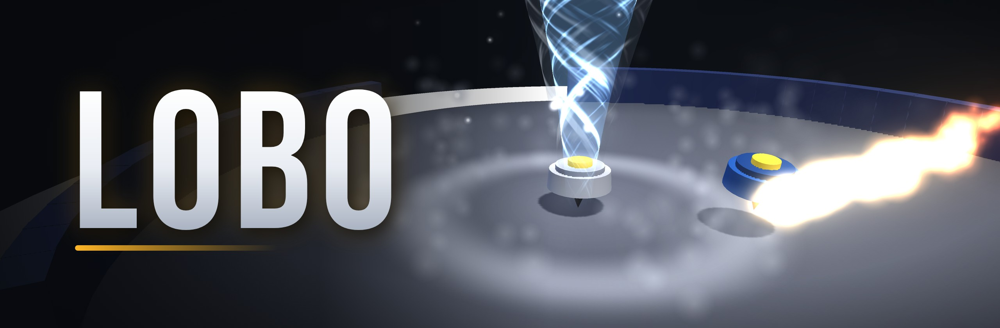
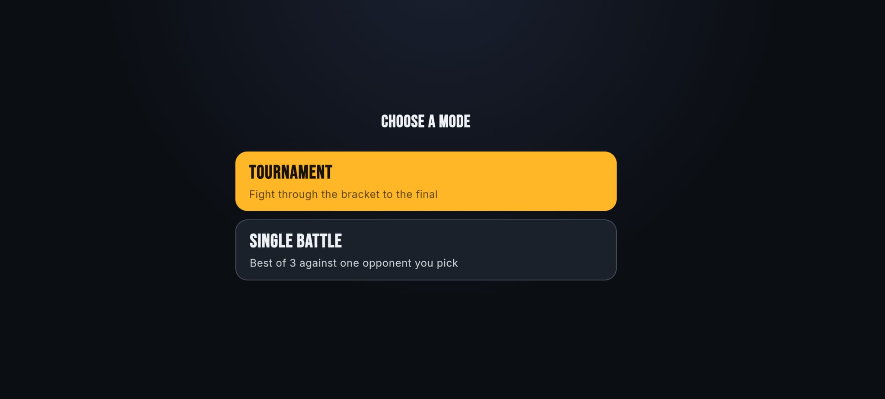
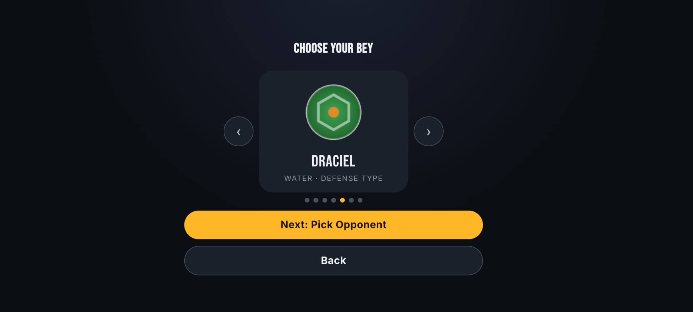
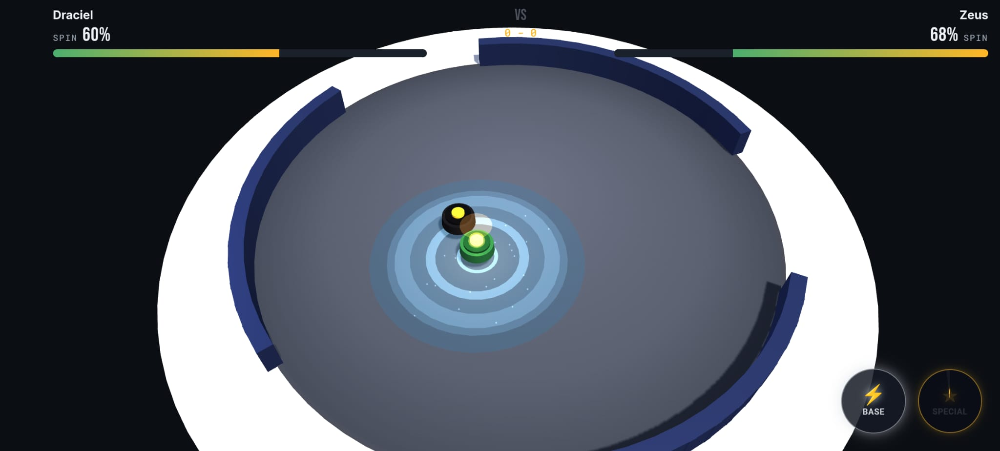

<p align="center">
  
</p>

<p align="center">
  <a href="https://atymia.github.io/Bey-Arena/"><b>▶ Play it in your browser</b></a> ·
  <a href="#how-a-battle-works">How it works</a> ·
  <a href="#the-spinners">Spinners</a> ·
  <a href="#controls">Controls</a> ·
  <a href="#playing-on-a-phone">On a phone</a> ·
  <a href="#running-it-locally">Run it locally</a>
</p>

---

Lobo is a small 3D battle game about spinning tops, inspired by the first Beyblade series (plus Zeus from G-Revolution). You pick a top, launch it into the stadium and steer it around, trying to knock your rival out of the ring or simply outlast it. On a phone you steer by tilting the screen, which is honestly the most fun way to play.

It runs entirely in the browser, no install needed:

**👉 [atymia.github.io/Bey-Arena](https://atymia.github.io/Bey-Arena/)**

It's a hobby project and still evolving, so if you try it, I'd love to hear what you think (see [Feedback](#feedback)).

## How a battle works

Each top starts at full spin, and spin is basically your health: it drops slowly over time and faster every time you get hit. A round ends when one top stops spinning, when one gets knocked into one of the KO pockets on the stadium wall, or when the timer runs out. In that case, whoever has more spin left wins.

The thing I cared about most is that **you** win the fight, not your top's stats:

- **How hard a hit lands depends on how you hit.** The faster you're moving when you crash into the other top, the more spin it loses. And whoever drives into the clash deals most of the damage, so sitting still and waiting is a bad idea.
- **Stats only nudge things.** A heavy defense type is harder to push around and an attack type is quicker, but the numbers only shift damage by a few percent. Picking Dranzer over Draciel doesn't decide the match.
- **Rubbing against each other doesn't count.** Two tops grinding together won't keep draining spin. Clean, separate hits do.
- **Every special move can be seen coming.** There's always a warning: a target on the ground, lightning markers, a ring closing in. If you move in time, you avoid it, whatever top you're using.

To check that no top is simply better than the others, I ran thousands of CPU-vs-CPU battles on the actual game code. At equal skill, every top wins somewhere around 40–60% of its games overall.

## The spinners

Every top has two moves:

- a **base move** that recharges quickly. You aim it when you press the button, and it can miss. If it lands, your special charges faster.
- a **special move** that charges up during the fight. It's the big one, with its own effect and sound.

| Spinner | Base move | Special move |
|---|---|---|
| **Dragoon** | **Gale Trail** – a dash that leaves a gust of wind behind; crossing it blows the rival sideways | **Sky Tornado** – a tornado follows Dragoon, lifts the rival up and throws it wherever you steer |
| **Dranzer** | **Flame Arc** – a dash that curves around towards the rival | **Phoenix Dive** – Dranzer flies up, you aim a target on the ground and it dives. If the rival dodges, Dranzer is left stunned |
| **Black Dranzer** | **Dark Claw** – the strongest dash, but a miss costs Black Dranzer some of its own spin | **Eclipse Drain** – a dark sphere that drains the rival's spin and gives it to Black Dranzer |
| **Driger** | **Twin Pounce** – two dashes in a row; you can re-aim the second one | **Thunder Claw** – three lunges. Tap in rhythm with the closing ring to make them land perfectly |
| **Draciel** | **Iron Shell** – blocks most of the damage. Raise it right before a hit and it **parries**, sending the damage back | **Maelstrom** – Draciel anchors itself inside a whirlpool that pulls the rival in and slows it down |
| **Wolborg** | **Frost Howl** – a cone of cold in front of Wolborg that slows whoever it touches | **White Blizzard** – the whole stadium freezes. The rival slides around, and if Wolborg touches it, it's sealed in ice |
| **Zeus** | **Mirror Guard** – soaks up a hit, then fires it back with a dash | **Dark Dimension** – half of every hit on Zeus bounces back, and lightning strikes where the rival is standing |

All the effects (fire, wind, water, ice, darkness, lightning) are drawn live with shaders and particles, and every move has its own sound, synthesized in the browser rather than loaded from audio files.

There are two modes: **Tournament**, where you work your way through a bracket to the final, and **Single Battle**, a best of 3 against an opponent you choose.

## Screenshots

<table>
  <thead>
    <tr>
      <th width="33%">Main menu</th>
      <th width="33%">Choosing a top</th>
      <th width="33%">In the arena</th>
    </tr>
  </thead>
  <tbody>
    <tr>
      <td align="center"></td>
      <td align="center"></td>
      <td align="center"></td>
    </tr>
  </tbody>
</table>

## Controls

| | Computer | Phone / tablet |
|---|---|---|
| **Steer** | Drag the on-screen joystick with the mouse | Tilt the phone (or use the joystick) |
| **Base move** | Base button | Base button |
| **Special move** | Special button, once it's charged | Special button, once it's charged |
| **Recalibrate tilt** | – | *Recalibrate tilt* on the result screen |

A few tips:
- Go after the rival. The one charging in deals the damage.
- The base move dashes in the direction you were aiming when you pressed it, so line it up first.
- Landing base moves is the fastest way to get your special back.
- When you see a warning on the ground, get out of the way.
- Keep away from the wall. That's where the KO pockets are.

## Playing on a phone

Open [atymia.github.io/Bey-Arena](https://atymia.github.io/Bey-Arena/) and hold the phone in landscape. For the best experience, add it to your home screen. It then opens fullscreen like a normal app (on iPhone this is the only way to get rid of Safari's bars).

| Android (Chrome) | iPhone (Safari) |
|---|---|
| 1. Tap **⋮** in the top right | 1. Tap **Share** (the square with the arrow) |
| 2. Tap **Add to Home screen** (or **Install app**) | 2. Scroll down and tap **Add to Home Screen** |
| 3. Confirm | 3. Tap **Add** |

Then open it from the new icon. A few things worth knowing:
- You need an internet connection, since the 3D engine is loaded online.
- On iPhone, the game asks for permission to use the motion sensors the first time. Tap **Allow** to steer by tilting, or just use the joystick.
- On iPhone, sounds are muted while the silent switch is on.
- If you still see an old version after an update, close the app completely and reopen it. The version number is shown on the start screen.

## Feedback

Bug reports and ideas are very welcome. You can open an issue in the [Issues](https://github.com/Atymia/Bey-Arena/issues) tab. It helps a lot if you mention:
- your device and browser (e.g. *iPhone 15, Safari* or *Windows, Chrome*),
- what happened, and which tops were fighting.

## Running it locally

There's no build step and nothing to install. It's plain HTML and JavaScript, and Three.js comes from a CDN. Any static server will do:

```bash
git clone https://github.com/Atymia/Bey-Arena.git
cd Bey-Arena
python3 -m http.server 8000
# then open http://localhost:8000
```

Opening `index.html` straight from disk (`file://`) mostly works, but motion sensors and the home-screen install won't. Those need a server, and on a phone they need HTTPS.

To publish your own copy on GitHub Pages, go to **Settings → Pages**, choose **Deploy from a branch**, pick `main` and the root folder, and it goes live at `https://<username>.github.io/<repo>/`. After pushing an update, use Ctrl+F5, because browsers (phones especially) like to keep the old files around.

### What's in here

```
├── index.html      the screens and buttons
├── style.css       look and layout, including the phone/landscape rules
├── game.js         the game itself: physics, combat, moves, CPU opponent, controls, 3D scene
├── fx.js           what the moves look like: shaders, particles, glow
├── sfx.js          what the moves sound like, synthesized with the Web Audio API
├── beys.js         the tops: stats, colors, move names and timings
├── hit.mp3         the clash sound
├── manifest.json   name, icon and orientation for the home-screen app
└── images/         banner, screenshots and app icons
```

## What's next

- [x] Damage based on skill rather than stats
- [x] New base and special moves with proper effects
- [x] A sound for every move
- [ ] Original names
- [ ] Real 3D models for each top
- [ ] More tops
- [ ] Offline play
- [ ] Online play (1v1, battle royal)
- [ ] Sound effect based on spinner

## Credits

Made with [Three.js](https://threejs.org/) (r128). Fonts: [Inter](https://rsms.me/inter/), Bebas Neue and Roboto Mono from Google Fonts.

This is an independent, non-commercial fan project. It isn't affiliated with or endorsed by the owners of Beyblade or any related toy or series, and all trademarks belong to their respective owners.

<!-- Add a LICENSE file and mention it here once you've decided how to license the project. -->
