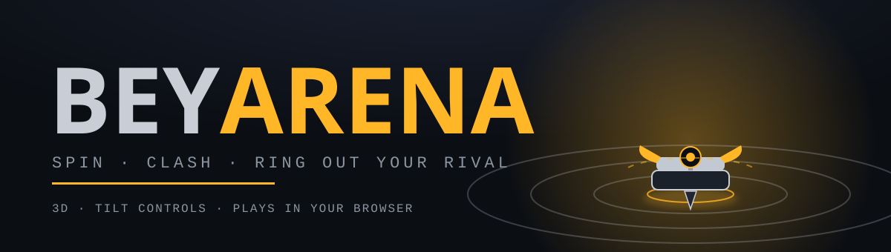

<p align="center">
  
</p>

<p align="center">
  <b>A fast, skill-based 3D spinning-top battle game that runs entirely in your browser.</b><br>
  Launch, steer, clash and ring out your rival — on a computer, or by tilting your phone.
</p>

<p align="center">
  <a href="https://atymia.github.io/Bey-Arena/"><b>▶ Play now</b></a> ·
  <a href="#features">Features</a> ·
  <a href="#moves">Moves</a> ·
  <a href="#controls">Controls</a> ·
  <a href="#screenshots">Screenshots</a> ·
  <a href="#play-on-your-phone">On your phone</a> ·
  <a href="#run-it-yourself">Run it</a>
</p>

---

## Play it

**[Play in your browser → atymia.github.io/Bey-Arena](https://atymia.github.io/Bey-Arena/)**

Nothing to download or install. It works in Chrome, Edge, Firefox and Safari, on desktop and on phones. On a phone, hold it **in landscape** — and see [how to add it to your home screen](#play-on-your-phone) so it opens like an app.

---

## Features

**Skill decides, not stats**
- **Damage comes from how a hit lands**: how fast you were moving at impact, and who drove into whom. The spinner that charges in deals most of the damage; the one that sits and waits takes it.
- **Stats only nudge things** by a few percent. Their real job is to change how a spinner *feels* — faster, heavier, longer-lasting — not to decide who wins.
- **Grinding doesn't stack damage.** Clean, separate hits do.
- **Every special can be read and countered**: a target on the ground, lightning markers, a closing ring. Moving out in time beats any stat.

**Battle**
- **Real-time 3D arena** built with Three.js — tops spin, wobble, collide and topple when they run out of steam.
- **Spin is your life bar.** It drains over time and with every clash. Run out, or get knocked into a KO pocket, and you lose the round.
- **Match timer**, so no battle drags on: the top with more spin left takes it.

**Look and sound**
- Move effects made with animated shaders (fire, wind, water, ice, darkness, lightning), particles and a glow that lights only the effects.
- **Every move has its own sound**, generated live in the browser: wind gusts, a phoenix cry and dive, crackling ice, a wolf howl, thunder, a whirlpool, a metal shell.

**Modes**
- **Tournament** — fight your way through a bracket to the final.
- **Single Battle** — best of 3 against the opponent you choose.

**Built for phones and desktops**
- **Tilt-to-steer** with your phone's motion sensors (with calibration), or an on-screen **joystick**.
- Fullscreen landscape layout; can be **added to the home screen** on Android and iPhone.
- Rendering tuned for laptops and mid-range phones; the glow switches itself off on slow devices.

---

## Moves

Each spinner has a **base move** (short cooldown, aimed when you press it — it can miss) and a **special move** (charges up during the fight). Landing a base move **shortens your special's cooldown**.

| Spinner | Base move | Special move |
|---|---|---|
| **Dragoon** | **Gale Trail** — a dash that leaves a gust; crossing it blows the rival sideways | **Sky Tornado** — a funnel follows you, lifts the rival and throws it where you steer |
| **Dranzer** | **Flame Arc** — a dash that curves around to its target | **Phoenix Dive** — fly up, steer a target on the ground, then dive. Dodge it, and Dranzer is stunned |
| **Black Dranzer** | **Dark Claw** — the hardest dash; if it misses, it burns its own spin | **Eclipse Drain** — a dark sphere that drains the rival and feeds Black Dranzer |
| **Driger** | **Twin Pounce** — two dashes, the second re-aimed | **Thunder Claw** — three lunges; tap in rhythm with the closing ring for perfect hits |
| **Draciel** | **Iron Shell** — blocks most damage; raised right before impact, it **parries** the hit back | **Maelstrom** — anchors in a whirlpool that pulls in and slows the rival |
| **Wolborg** | **Frost Howl** — a cone that slows whoever it touches | **White Blizzard** — the stadium freezes: the rival slides, and a touch seals it in ice |
| **Zeus** | **Mirror Guard** — absorbs a hit, then releases it with a dash | **Dark Dimension** — half of every hit on Zeus turns back; lightning strikes where the rival stands |

**Balance:** tuned with thousands of simulated CPU-vs-CPU battles on the real game engine. At equal skill, every spinner wins roughly 40–60% of its games overall.

---

## Controls

| | Computer | Phone / tablet |
|---|---|---|
| **Steer** | On-screen joystick (drag with the mouse) | **Tilt the phone** (or the joystick) |
| **Base move** | Base button | Base button |
| **Special move** | Special button (when charged) | Special button (when charged) |
| **Recalibrate tilt** | — | *Recalibrate tilt* on the result screen |

**Tips**
- Drive into the rival, don't wait to be hit.
- Time your base move: it dashes along the line you were aiming at when you pressed it.
- Chain base hits to charge your special faster.
- Watch for the warnings and get out of the way.
- Stay off the wall: the KO pockets are waiting.

---

## Screenshots

<table>
  <thead>
    <tr>
      <th width="33%">Main Menu</th>
      <th width="33%">Spinner Selection</th>
      <th width="33%">Arena Battle</th>
    </tr>
  </thead>
  <tbody>
    <tr>
      <td align="center"></td>
      <td align="center"></td>
      <td align="center"></td>
    </tr>
  </tbody>
</table>

---

## Play on your phone

Open **[atymia.github.io/Bey-Arena](https://atymia.github.io/Bey-Arena/)** on the phone, then add it to the home screen so it opens fullscreen, like an app:

| Android (Chrome) | iPhone (Safari) |
|---|---|
| 1. Tap the **⋮** menu (top right) | 1. Tap the **Share** button (square with an arrow) |
| 2. Tap **Add to Home screen** (or **Install app**) | 2. Scroll down and tap **Add to Home Screen** |
| 3. Confirm with **Install** / **Add** | 3. Tap **Add** (top right) |

Good to know:
- **Internet is needed** to play (the 3D engine loads online).
- **Tilt controls:** on iPhone, the first time, Safari asks for permission to use motion sensors — tap **Allow**. You can always use the on-screen joystick instead.
- **iPhone:** sounds are muted when the side **silent switch** is on.
- After an update, if you still see the old version, close the app completely and open it again. The version number is on the start screen.

---

## Feedback

Found a bug or have an idea? Open an issue in the **[Issues](https://github.com/Atymia/Bey-Arena/issues)** tab. Please include:
- the **version** shown on the start screen (e.g. `v42`),
- your device and browser (e.g. *iPhone 15, Safari* or *Windows, Chrome*),
- what happened and which spinners were fighting.

---

## Run it yourself

No build step and nothing to install: it is plain HTML + JavaScript, with Three.js loaded from a CDN.

```bash
git clone https://github.com/Atymia/Bey-Arena.git
cd Bey-Arena

# Any static server works, for example:
python3 -m http.server 8000
# then open http://localhost:8000
```

> Opening `index.html` directly (`file://`) blocks some features (motion sensors, home-screen install).
> Use a local server, or HTTPS on a phone — motion sensors need a secure connection.

### Deploy on GitHub Pages

1. Push the files to your repository.
2. **Settings → Pages → Build and deployment → Deploy from a branch** → choose `main` / root.
3. The game goes live at `https://<your-username>.github.io/<your-repo>/` over HTTPS, which tilt controls need.

After updating, hard-refresh the page (Ctrl+F5): browsers, especially on phones, cache aggressively.

---

## Project structure

```
├── index.html          # Screens and UI markup
├── style.css           # Theme, layout, mobile fullscreen / landscape rules
├── game.js             # Engine: physics, combat, moves, CPU, controls, 3D scene
├── fx.js               # Move visuals: shaders, particles, glow (looks only)
├── sfx.js              # Move sounds, synthesized live with the Web Audio API
├── beys.js             # Roster: stats, colors, move names and timings
├── hit.mp3             # Clash sound
├── manifest.json       # Home-screen app settings (name, icon, landscape)
└── images/             # README banner and screenshots, app icons
```

**Where to tweak things**
- Spinner stats, colors and moves → `beys.js`
- Combat numbers (hit damage, stat ranges, knockback, parry window) → top of `game.js`
- What each move does → `triggerBaseMove` / `stepSpecial` in `game.js`
- How each move looks → the `kit…` functions in `fx.js`
- How each move sounds → the `BASE`, `SPECIAL` and `EVENTS` tables in `sfx.js`
- Arena size, walls, KO pockets → the `ARENA` constants and `buildStadium` in `game.js`

---

## Roadmap

- [x] Skill-based damage (impact speed and who attacks, not stats)
- [x] New base and special moves with shader effects
- [x] Synthesized sound for every move
- [ ] Original names and art
- [ ] Custom 3D models (`.glb`) with a fallback
- [ ] More spinners
- [ ] Offline play
- [ ] Music

Ideas and bug reports are welcome in the **[Issues](https://github.com/Atymia/Bey-Arena/issues)** tab.

---

## Credits & disclaimer

- Built with [Three.js](https://threejs.org/) (r128).
- The architecture for per-spinner abilities and effects was informed by studying the open-source project [BeyWeb](https://github.com/LakshmanChelliah/BeyWeb).
- This is an **independent fan-made project**. It is not affiliated with, endorsed by, or sponsored by the makers of any commercial spinning-top toy or animated series. All trademarks belong to their respective owners.

<!-- Add a LICENSE file and state it here once you decide how you want to license the project. -->
