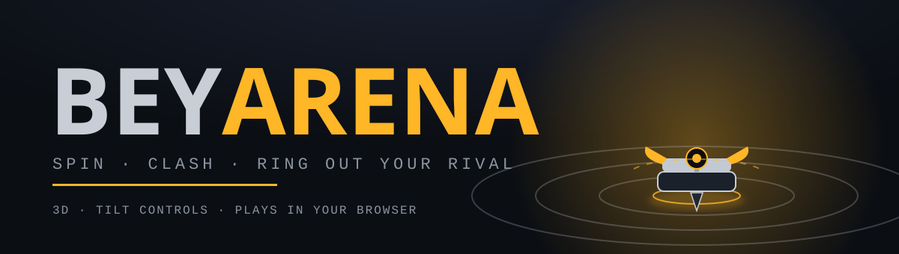
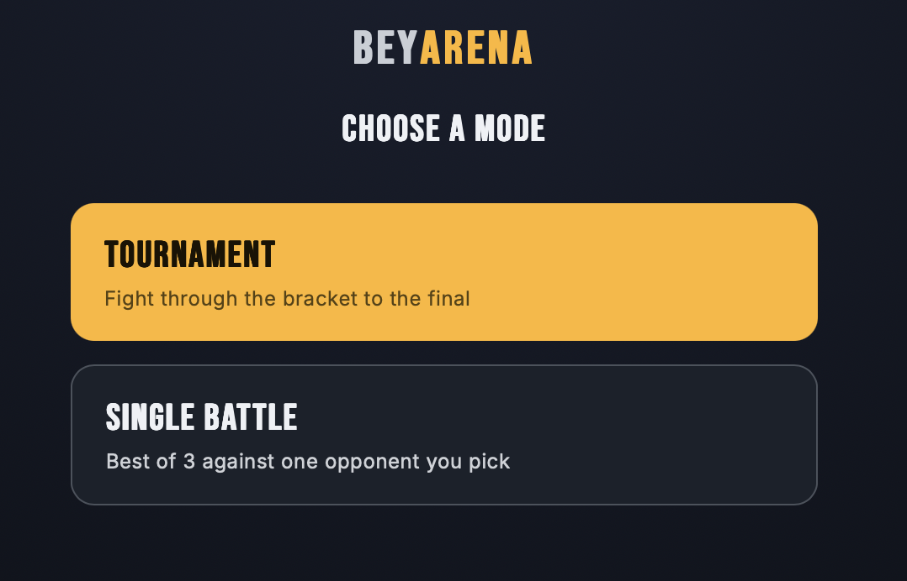
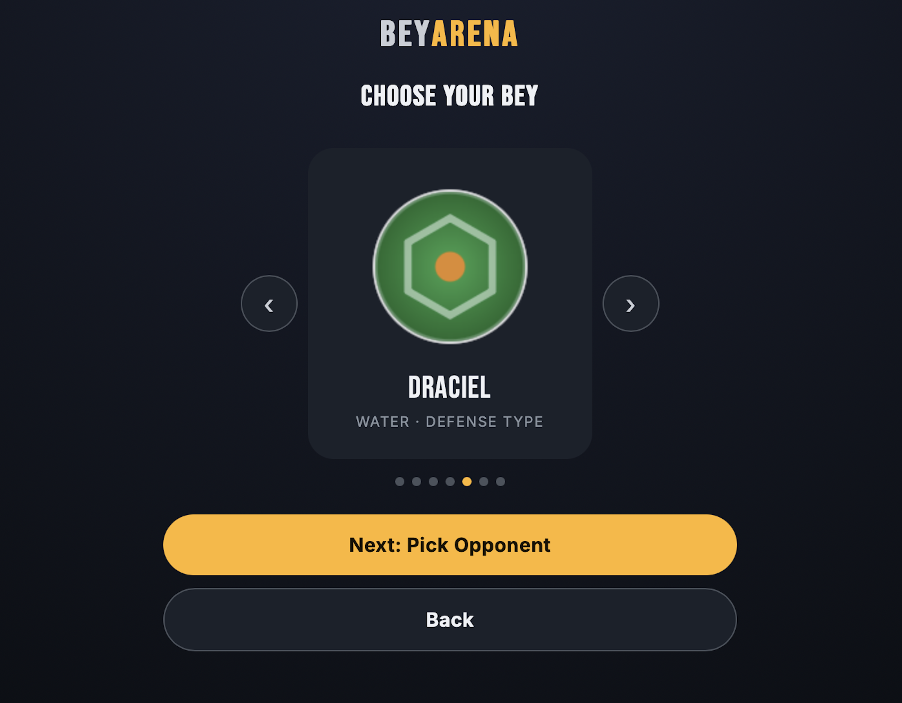
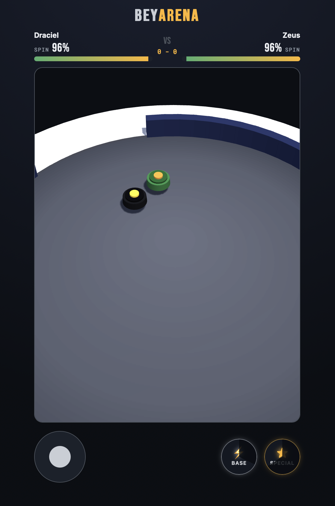

<p align="center">
  
</p>

<p align="center">
  <b>A fast, skill-based 3D spinning-top battle game that runs entirely in your browser.</b><br>
  Launch, steer, clash, and ring out your rival — on desktop or by tilting your phone.
</p>

<p align="center">
  <a href="#-play-it">Play</a> ·
  <a href="#-features">Features</a> ·
  <a href="#-controls">Controls</a> ·
  <a href="#-screenshots">Screenshots</a> ·
  <a href="#-run-it-yourself">Run it</a> ·
  <a href="#-roadmap">Roadmap</a>
</p>

---

## Play it

**[Play in your browser →](https://atymia.github.io/Bey-Arena/)**

> Replace the link above with your GitHub Pages URL (see [Deploy](#-deploy-on-github-pages)).
> For the best experience on a phone, hold it **in landscape** and add the page to your home screen.

---

## Features

**Battle**
- **Real-time 3D arena** built with Three.js — tops spin, wobble, collide, and topple when they run out of steam.
- **Spin is your life bar.** Every top constantly loses spin; clashes drain it faster. Lose all your spin, or get knocked into a KO pocket, and you lose the round.
- **Physics-driven clashes** — knockback depends on mass and defense, with a short impact cooldown so fights read clearly.
- **Match timer** so no battle drags on forever; the top with more spin left takes it.

**Skill-based abilities**
- **Base move** (quick cooldown): aim-locked and committed — you pick the moment, and it can miss. Landing it grants a bonus hit and **shortens your special's cooldown**.
- **Special move** (charged, 2-second show): each spinner has its own signature move with its own visual effect. Its damage is spread over the duration, and it only hurts if the rival is **inside the effect**.
- Some spinners bend the rules: one fires a clip of **ice shards** that can hit or miss, one raises a **shell guard** that blocks base-move damage and counter-shoves, one **pulls rivals into a tidal field**, one **freezes the rival in ice** while snow falls across the arena.

**Roster & balance**
- **7 spinners** with distinct stats, movement personalities, colors, and element-themed effects (wind, fire, dark fire, lightning, water, ice, storm).
- A gentle **type triangle** (attack > stamina > defense > attack) nudges matchups without deciding them.
- Balanced with a round-robin simulation so every spinner has favorable and unfavorable matchups — skill decides the close ones.

**Modes**
- **Tournament** — fight your way through a bracket to the final.
- **Single Battle** — best of 3 against an opponent you choose.

**Built for phones and desktops**
- **Tilt-to-steer** using your device's motion sensors, with calibration, plus an on-screen **joystick** fallback.
- Fullscreen landscape layout, safe-area aware, installable as a **PWA**.
- Pixel-ratio and shadow settings tuned to keep it smooth on laptops and mid-range phones.

---

## Controls

| | Desktop | Phone / tablet |
|---|---|---|
| **Steer** | On-screen joystick (mouse drag) | **Tilt the device** (or joystick) |
| **Base move** |  button |  button |
| **Special move** | button (when charged) | button (when charged) |
| **Recalibrate tilt** | — | *Recalibrate tilt* on the result screen |

**Tips**
- Time your base move — it dashes along the line you were aiming at when you pressed it.
- Chain base hits to refill your special faster.
- Specials only hurt inside their effect, so close the distance (or lure the rival in).
- Stay off the wall: the KO pockets are waiting.

---

## Screenshots

<table align="center">
  <tr>
    <td align="center" colspan="2">
      <b>Main Menu</b><br>
      
    </td>
  </tr>
  <tr>
    <td align="center" width="50%" align="top">
      <b>Spinner Selection</b><br>
      
    </td>
    <td align="center" width="50%" align="top">
      <b>Arena Battle</b><br>
      
    </td>
  </tr>
</table>

---

## Run it yourself

No build step, no dependencies to install. It is plain HTML + JavaScript (Three.js is loaded from a CDN).

```bash
git clone https://github.com/YOUR-USERNAME/YOUR-REPO.git
cd YOUR-REPO

# Any static server works. For example:
python3 -m http.server 8000
# then open http://localhost:8000
```

> Opening `index.html` directly with `file://` can block some browser features (motion sensors, PWA).
> Use a local server, or HTTPS on a phone — motion sensors require a secure context.

### Deploy on GitHub Pages

1. Push the files to your repository.
2. **Settings → Pages → Build and deployment → Deploy from a branch** → choose `main` / root.
3. Your game will be live at `https://YOUR-USERNAME.github.io/YOUR-REPO/` (served over HTTPS, which tilt controls need).

After updating, hard-refresh (or clear the site cache) — mobile browsers cache aggressively. The start screen shows a small version stamp so you can tell which build you are running.

---

## 🗂 Project structure

```
├── index.html      # Screens and UI markup
├── style.css       # Theme, layout, mobile fullscreen / landscape rules
├── game.js         # Engine: physics, combat, AI, controls, 3D rendering, effects
├── beys.js         # Roster data: stats, colors, types, move definitions
├── hit.mp3         # Impact sound
├── manifest.json   # PWA manifest
├── assets/         # README banner
└── screenshots/    # Images shown in this README
```

**Where to tweak things**
- Spinner stats, colors, and moves → `beys.js`
- Combat numbers (damage scaling, spin loss caps, knockback, type triangle) → top of `game.js`
- Arena size, walls, KO pockets → the `ARENA` constants and `buildStadium` in `game.js`
- Special/base move visuals → the `build…Vfx` functions in `game.js`

---

## Roadmap

- [ ] Assemblable spinners (blade / weight / tip) with stat trade-offs
- [ ] Bowl-shaped stadium with tiers
- [ ] Original character names and art, ready for release
- [ ] Custom 3D models (`.glb`) with procedural fallback
- [ ] Music and richer sound design
- [ ] Progression and unlockable parts
- [ ] Desktop build for Steam

Ideas and bug reports are welcome in the **Issues** tab.

---

## 🙏 Credits & disclaimer

- Built with [Three.js](https://threejs.org/) (r128).
- Architecture for per-spinner abilities and effects was informed by studying the open-source project [BeyWeb](https://github.com/LakshmanChelliah/BeyWeb).
- This is an **independent fan-made project**. It is not affiliated with, endorsed by, or sponsored by the makers of any commercial spinning-top toy or animated series. All trademarks belong to their respective owners.

<!-- Add a LICENSE file and state it here once you decide how you want to license the project. -->
